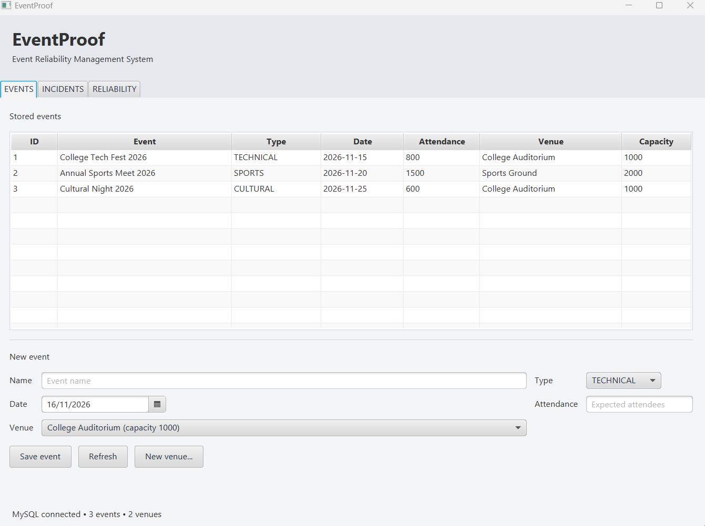
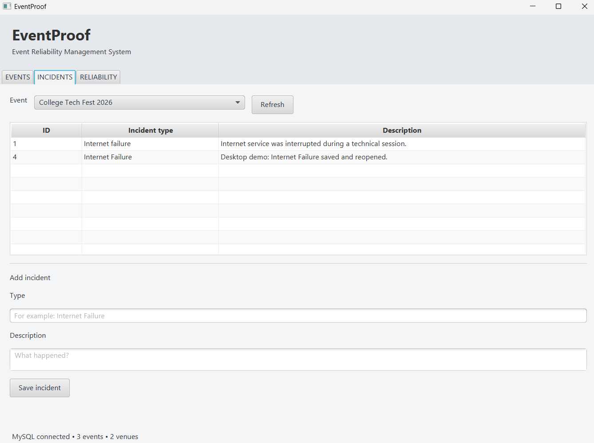
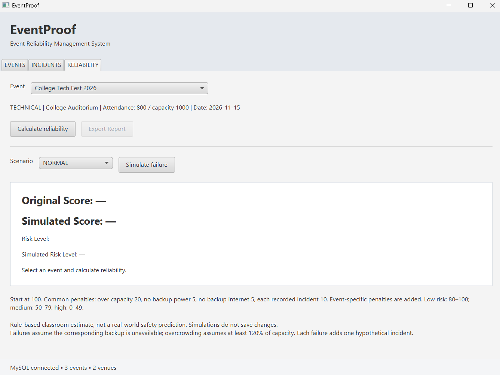
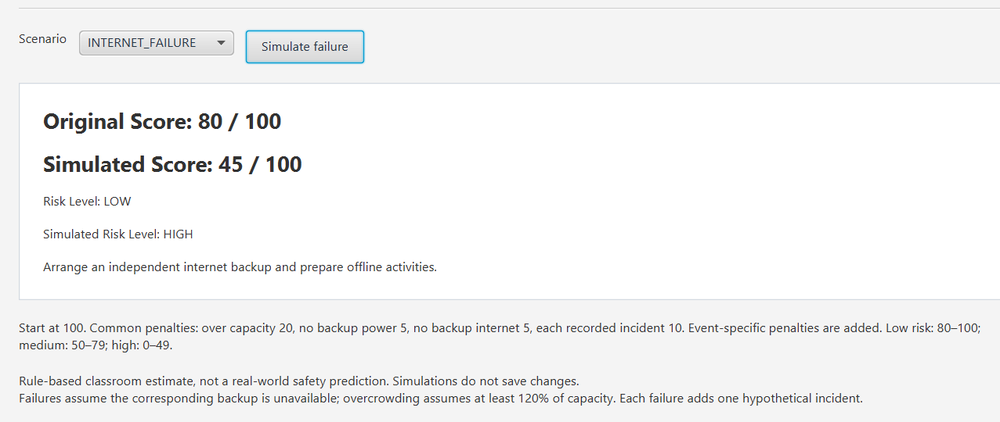
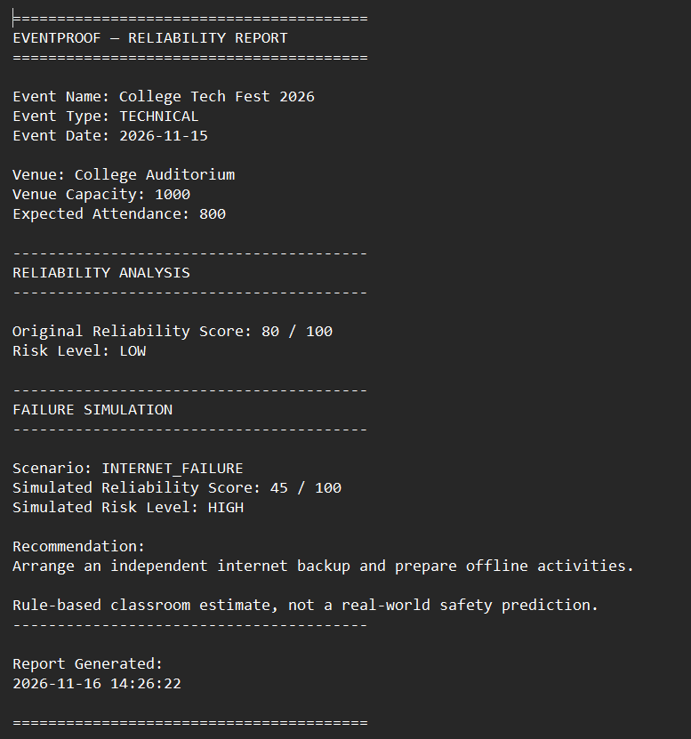
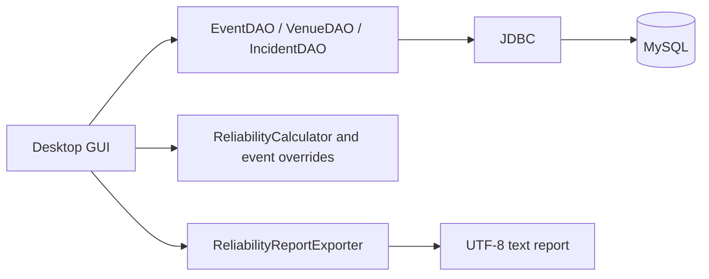

# EventProof — Event Reliability Management System

EventProof is a desktop GUI application for organizing events, recording incidents,
calculating reliability scores and comparing failure scenarios. It stores event data
in MySQL and exports readable text reports.

Built as a second-year B.Tech **Advanced Object-Oriented Programming** project,
EventProof demonstrates OOP concepts through a small, practical Java application.
Reliability scores are **rule-based classroom estimates, not real-world safety predictions**.

## Problem statement

An event can be disrupted by power interruptions, unreliable internet or attendance
that exceeds venue capacity. When event details and incident history are scattered,
organizers can overlook these conditions during planning.

EventProof brings the records together and applies transparent scoring rules. Users
can inspect an event's facilities, review recorded incidents and compare its current
score with a hypothetical failure without changing the saved event.

## Real-world applications

The project illustrates planning workflows relevant to these settings:

| Setting | Example use |
| --- | --- |
| Colleges | Organize technical fests, cultural programs and interdepartmental sports meets. |
| Sports events | Compare expected attendance with venue capacity and review crowd-related incidents. |
| Conferences | Represent technical sessions and examine power or internet failure scenarios. |
| Event management companies | Use a small event register and incident history for planning exercises or staff training. |

## Features

| Feature | Implemented behavior |
| --- | --- |
| Event management | Create and display technical, cultural and sports events with a date, expected attendance and selected venue; refresh saved records. |
| Venue management | Create venues with a capacity and backup power/internet settings, then select them when creating events. |
| Incident tracking | Record an incident type and description against an event, and display that event's saved history. |
| Reliability calculation | Calculate a score from 0 to 100 using venue conditions, attendance, recorded incidents and event-specific penalties; classify risk as LOW, MEDIUM or HIGH. |
| Failure simulation | Compare original and simulated scores for internet failure, power failure or overcrowding, with a scenario-specific recommendation. |
| Report generation | Export event details, calculated scores, risk levels, an optional simulation and a generation timestamp to a UTF-8 `.txt` file. |
| MySQL persistence | Save venues, events and incidents through JDBC and reload them after reopening the application. |

Input validation and error dialogs handle invalid forms, database failures and report
write errors. Export is enabled after a successful calculation. Changing the event
invalidates its earlier results; changing the scenario clears only simulation results.

## Application screenshots

The images below are actual captures stored in [`docs/screenshots/`](docs/screenshots/).
They show a recorded demonstration; scores depend on the incident history at calculation time.

### Events and venues

Saved MySQL events with their dates, attendance, venue names and capacities.



### Incident tracking

Persisted incident records for College Tech Fest 2026.



### Reliability screen

Event selection and assessment controls, captured **before calculation**.



### Internet failure simulation

An actual comparison of original and simulated scores, risk levels and recommendation.



### Exported report

A generated reliability report opened in a text editor.



## Technology stack

| Technology | Role |
| --- | --- |
| Java 25 | Application language and JDK target. |
| Object-oriented programming | Domain models, inheritance, abstraction, interfaces and runtime polymorphism. |
| MySQL 8 | Persistent relational storage. |
| JDBC / MySQL Connector/J 9.5.0 | Prepared statements, result mapping and database connections. |
| Maven | Dependency management, compilation, testing and application launch. |
| JavaFX Controls 25.0.1 | Desktop GUI implementation. |
| JUnit Jupiter 6.0.3 | Automated model, reliability, report and JDBC tests. |

The application uses plain JDBC and Java Standard Library APIs. Its direct
dependencies are the GUI controls library, MySQL Connector/J and JUnit.

## OOP concepts demonstrated

| Concept | Actual implementation |
| --- | --- |
| Encapsulation | `Event` keeps fields private and validates changes through setters. `Venue` and `Incident` expose their private constructor-initialized fields through getters. |
| Abstraction | Abstract `Event` shares event data and declares `calculateReliabilityPenalty()`. |
| Inheritance | `TechnicalEvent`, `CulturalEvent` and `SportsEvent` extend `Event`. |
| Polymorphism | `ReliabilityCalculator` invokes the same penalty method and Java selects the concrete event's overridden implementation at runtime. |
| Interfaces | `ReliabilityAssessable` defines the penalty contract; `Event` implements it and its subclasses supply the behavior. |

The calculator uses the interface directly:

```java
ReliabilityAssessable assessment = event;
int penalty = assessment.calculateReliabilityPenalty();
```

DAOs return collections such as `List<Event>` and `List<Incident>`. Event validation
uses `InvalidEventDataException`, an unchecked subclass of `IllegalArgumentException`.
Views catch checked `SQLException` and `IOException` failures and show readable
messages. JDBC resources close through try-with-resources.

## Package structure

Production code lives under `src/main/java/com/eventproof/`.

| Package | Purpose and main types |
| --- | --- |
| `com.eventproof` | Entry points: `EventProofApp`, `DatabaseSetup`, `PolymorphismDemo` and `ExceptionHandlingDemo`. |
| `com.eventproof.model` | Domain data and the reliability contract: `Event`, its three subclasses, `Venue`, `Incident` and `ReliabilityAssessable`. |
| `com.eventproof.ui` | Desktop screens and shared alerts: `EventsView`, `IncidentsView`, `ReliabilityView` and `UiMessages`. |
| `com.eventproof.reliability` | Business rules and simulation results: `ReliabilityCalculator`, `FailureScenario`, `RiskLevel` and `SimulationResult`. |
| `com.eventproof.dao` | Database operations: `EventDAO`, `VenueDAO` and `IncidentDAO`. |
| `com.eventproof.config` | Local configuration loading and JDBC connections: `DatabaseConfig` and `DatabaseConnection`. |
| `com.eventproof.report` | `ReliabilityReportExporter`, which formats supplied calculation results and writes text files. |
| `com.eventproof.exception` | `InvalidEventDataException` for invalid event data. |

SQL scripts and styling live in `src/main/resources/`; tests live in `src/test/java/`.

## Database design

The `eventproof_oop` database contains exactly three tables:

| Table | Fields and keys |
| --- | --- |
| `venues` | Auto-increment `id` primary key; `name`, positive `capacity`, `backup_power` and `backup_internet`. |
| `events` | Auto-increment `id` primary key; `name`, `event_date`, nonnegative `expected_attendance`, `venue_id` foreign key and `event_type`. |
| `incidents` | Auto-increment `id` primary key; `event_id` foreign key, `incident_type` and `description`. |

Relationships:

- One venue can host many events: `events.venue_id` references `venues.id`.
- One event can have many incidents: `incidents.event_id` references `events.id`.

`event_type` stores `TECHNICAL`, `CULTURAL` or `SPORTS`. `EventDAO` joins the event
with its venue and reconstructs the corresponding Java subclass from each result row.
DAOs bind input with `PreparedStatement` and read records using `ResultSet`.

See the [schema](src/main/resources/db/schema.sql) and
[repeatable sample data](src/main/resources/db/sample-data.sql).

## Reliability calculation and failure scenarios

`ReliabilityCalculator` starts at **100** and subtracts common penalties plus the
penalty returned by the event subclass. The final score is clamped to **0–100**.
Only incidents belonging to the selected event count toward its score.

| Common condition | Penalty |
| --- | ---: |
| Expected attendance exceeds venue capacity | 20 |
| Backup power is unavailable | 5 |
| Backup internet is unavailable | 5 |
| Each recorded incident | 10 |

| Event type | Additional penalty |
| --- | --- |
| Technical | 15 without backup power and 20 without backup internet. |
| Cultural | 20 without backup power for sound and lighting. |
| Sports | 25 when attendance exceeds venue capacity. |

The common and event-specific penalties add together. Incident penalties are capped
at ten incidents internally, since they already exhaust the starting score.

| Score | Risk level |
| --- | --- |
| 80–100 | LOW |
| 50–79 | MEDIUM |
| 0–49 | HIGH |

Simulation creates separate `Event` and `Venue` objects and applies the same rules:

| Scenario | Simulated change |
| --- | --- |
| `NORMAL` | No changes; original and simulated scores match. |
| `INTERNET_FAILURE` | Backup internet becomes unavailable; add one hypothetical incident. |
| `POWER_FAILURE` | Backup power becomes unavailable; add one hypothetical incident. |
| `OVERCROWDING` | Attendance becomes at least capacity plus 20%, rounded up; add one hypothetical incident. |

An already higher attendance is preserved. Failure scenarios assume the corresponding
backup is unavailable. Simulations do not change saved events, venues or incident history.

## Project architecture

The GUI coordinates database access, calculation and report export:



The screens load data through DAOs and pass domain objects to the calculator.
The report exporter receives an event and already-calculated results; it formats
and saves them without querying the database or applying new scoring rules.

## Installation and execution on Windows

### Prerequisites

- JDK **25**, with `java` available on PATH.
- Maven **3.9+**, with `mvn` available on PATH.
- MySQL **8**, with the server running and a local database account configured.
- Git to clone the repository, and internet access for the first dependency download.

Check the Java and Maven installations:

```powershell
java -version
mvn -version
```

### 1. Clone the project

```powershell
git clone https://github.com/sourin-git/eventproof-oop.git
cd eventproof-oop
```

### 2. Configure the local database connection

Copy the example configuration if the local file does not already exist:

```powershell
Copy-Item src/main/resources/database.properties.example src/main/resources/database.properties
```

Edit `src/main/resources/database.properties` with your local connection settings:

```properties
db.url=jdbc:mysql://localhost:3306/eventproof_oop
db.user=YOUR_MYSQL_USERNAME
db.password=YOUR_MYSQL_PASSWORD
```

The configuration requires the database name `eventproof_oop`. The real local file
is ignored by Git and excluded from Maven resource copying. Keep credentials private.

### 3. Initialize the database

With MySQL running, use an account permitted to create the database and tables:

```powershell
mvn "-Dmaven.repo.local=.maven-repository" compile javafx:run "-Dapp.mainClass=com.eventproof.DatabaseSetup"
```

`DatabaseSetup` loads the schema and sample data, then prints database counts and
stored events. Sample loading uses stable IDs and preserves rows with existing IDs.
The sample events are College Tech Fest 2026, Annual Sports Meet 2026 and Cultural
Night 2026. An already-configured installation can proceed directly to launch.

### 4. Launch the application

Double-click **`launch-eventproof.cmd`**, or run it from PowerShell:

```powershell
.\launch-eventproof.cmd
```

The launcher changes to the project directory and runs this Maven command:

```powershell
mvn "-Dmaven.repo.local=.maven-repository" javafx:run
```

It keeps Maven's normal output and pauses on failure so the error can be read.
When using Maven directly, run from the repository root so local configuration can
be found. Close the application window to exit. The local-cache option stores Maven
dependencies in `.maven-repository/`; it can be omitted to use Maven's default cache.

If database access fails, check that MySQL is running, the local connection settings
are correct and database setup has completed, then use **Refresh** on EVENTS.

## Sample demonstration workflow

1. Launch EventProof and inspect the saved events on **EVENTS**. Point out College
   Tech Fest 2026, its venue capacity and expected attendance.
2. Open **RELIABILITY**, select that event and click **Calculate reliability**.
   Read the actual score and original risk level.
3. Select `INTERNET_FAILURE` and click **Simulate failure**. Compare the scores,
   risk levels and recommendation. Try another scenario to clear the old simulation.
4. On **INCIDENTS**, select the same event and save an incident with a distinct
   description. Close and reopen the application to show that the record persists.
5. Return to **RELIABILITY** and **recalculate**, because incident history changed.
   Run the desired simulation again.
6. Click **Export Report**, save the `.txt` file and open it in a text editor.
   Compare the event details, scores, risk levels, scenario and timestamp.
7. To demonstrate creation, use **New venue...** on EVENTS, then create an event
   using that venue, an event type, date and expected attendance.

Saving an incident adds to the event's history and affects later calculations.
Exports use the last successful calculation, so recalculate after recording incidents.
Without a simulation, the report explicitly marks simulation results as not applicable.

For the timed walkthrough and viva questions, see the [demo guide](docs/DEMO_GUIDE.md).
The [final Review 3 presentation](docs/presentations/EventProof_Review_3_Complete.pptx)
is also included in the repository.

## Testing and verification

Run the automated suite from the repository root:

```powershell
mvn "-Dmaven.repo.local=.maven-repository" test
```

For a clean rebuild, close the running application first and use:

```powershell
mvn "-Dmaven.repo.local=.maven-repository" clean test
```

**Verified on 20 November 2026:** Maven reported **30 tests passed, 0 failures,
0 errors and 0 skipped**, including the two live, read-only MySQL integration tests.

| Test area | Tests |
| --- | ---: |
| Event models and subclass behavior | 4 |
| Interface-based polymorphism | 2 |
| Reliability rules, risk thresholds and simulation | 6 |
| Custom event-data exceptions | 5 |
| Report contents, UTF-8, timestamps and I/O failures | 11 |
| MySQL connectivity, schema tables and event reconstruction | 2 |
| **Total** | **30** |

Report tests use temporary directories and in-memory objects. Live JDBC tests skip
when the ignored local configuration is absent; when it is present, they require
the configured database and sample records.

Two small console demonstrations can be run after compilation:

```powershell
java -cp target/classes com.eventproof.PolymorphismDemo
java -cp target/classes com.eventproof.ExceptionHandlingDemo
```

See [Review 2 documentation](docs/REVIEW2.md) for package, library and exception examples.

## Team members

- Panshul Agarwal
- Sourin Nandy
- Deepjyoti Pal

## Repository and review milestones

[GitHub repository: sourin-git/eventproof-oop](https://github.com/sourin-git/eventproof-oop)

| Review | Focus | Preserved checkpoint |
| --- | --- | --- |
| Review 1 | GUI, MySQL database design and JDBC | [review-1](https://github.com/sourin-git/eventproof-oop/tree/review-1) |
| Review 2 | Packages, interfaces, Java Standard Library and exception handling | [review-2](https://github.com/sourin-git/eventproof-oop/tree/review-2) |
| Review 3 | Final application development and presentation | [review-3](https://github.com/sourin-git/eventproof-oop/tree/review-3) |
